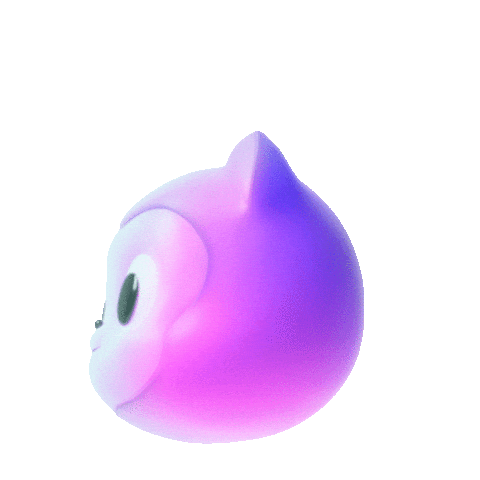

<h1 align="center">Your Name</h1>
<h3 align="center">Senior Software Engineer</h3>

<p align="center">
  Full-stack systems: APIs, real-time UI, and cloud deployments.
</p>

<p align="center">
  <a href="https://github.com/tomost8">github.com/tomost8</a>
</p>

### About

- 10+ years building web apps, backend services, and cloud deployments
- Microservices, real-time systems, and dashboards
- B.S. in Computer Science
- Mentoring junior engineers

### Now

- Building microservices, real-time systems, and dashboards
- Depth in TypeScript, React, Node.js, and cloud deployment
- Ask me about system design, ASP.NET Core, Django, and mentoring

### Stack

```javascript
const stack = {
  daily: ["TypeScript", "JavaScript", "React", "Node.js", "Python", "C#"],
  frameworks: ["ASP.NET Core", "Django", "Ruby on Rails"],
  platform: ["AWS", "Azure", "Docker", "Kubernetes", "MySQL", "GraphQL", "Jest"],
};
```

**Languages:**


**Libraries & Frameworks:**


**Tools & Platforms:**


**Databases:**


### Selected work

<table>
  <tr>
    <td>
      <a href="https://github.com/tomost8/Thoughtful-AI-assessment"><b>Thoughtful-AI-assessment</b></a><br />
      Python
    </td>
    <td>
      <a href="https://github.com/tomost8/developer-portfolio"><b>developer-portfolio</b></a><br />
      JavaScript
    </td>
  </tr>
</table>

### Stats

<p align="center">
  
</p>

<p align="center">
  
  
  
</p>

<p align="center">
  
</p>

### Random Dev Quote

<p align="center">
  
</p>

### Contribution snake

<p align="center">
  
</p>

<div align="center">

```diff
+@ @ @ @ @ @ @ @ @ @ @ @ @ @ @ @ @ @ @ @ @ @ @ @ @ @ @ @+
@@       o o                                           @@
@@       | |                                           @@
@@      _L_L_                                          @@
@@   ❮\/__-__\/❯  A habit missed once is a mistake,    @@
@@   ❮(|~o.o~|)❯    A habit missed twice is a start    @@
@@   ❮/ \`-'/ \❯          of new habit!                @@
@@     _/`U'\_                                         @@
@@    ( .   . )     .----------------------------.     @@
@@   / /     \ \    | while( ! (succed=try() ) ) |     @@
@@   \ |  ,  | /    '----------------------------'     @@
@@    \|=====|/                                        @@
@@     |_.^._|                                         @@
@@     | |"| |                                         @@
@@     ( ) ( )   Testing leads to failure              @@
@@     |_| |_|   and failure leads to understanding    @@
@@ _.-' _j L_ '-._                                     @@
@@(___.'     '.___)                                    @@
+@ @ @ @ @ @ @ @ @ @ @ @ @ @ @ @ @ @ @ @ @ @ @ @ @ @ @ @+
```

</div>


### Collaboration

Open to full-stack builds and mentoring.

[github.com/tomost8](https://github.com/tomost8)

<p align="center">Senior Software Engineer</p>
